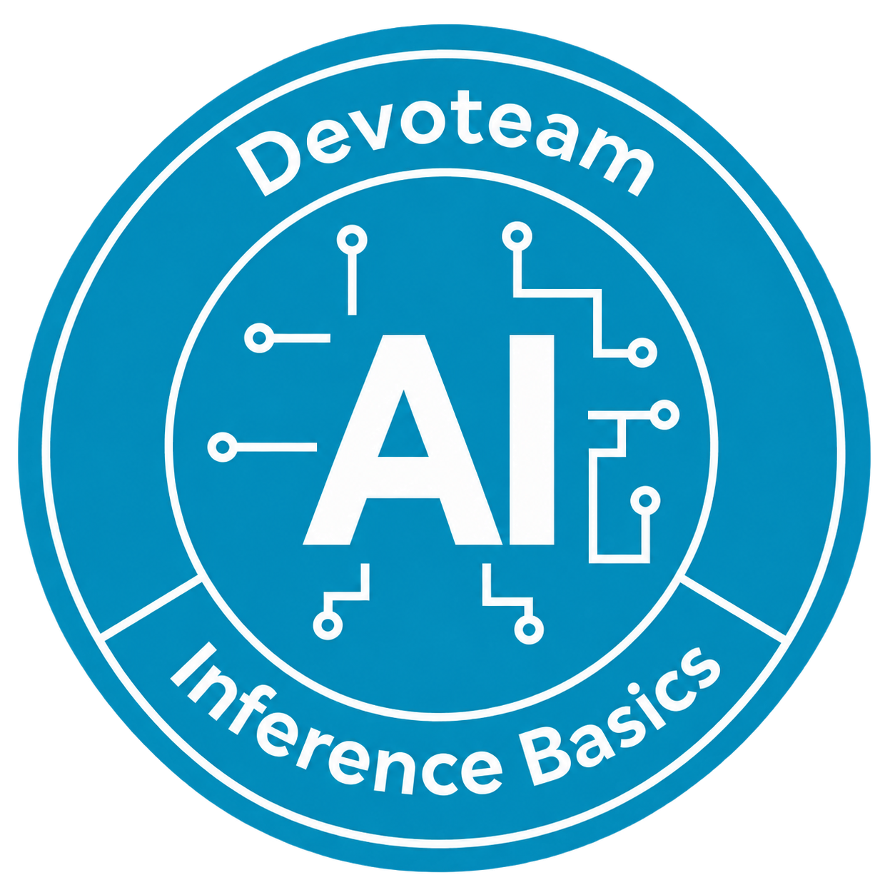

# AI Inference Basics



A disposable, browser-first Kubernetes inference lab for **Who Killed Kubernetes?**
Native single-node k0s runs three official Qwen models behind Envoy Gateway and
Agent Router (Envoy AI Gateway). Helm owns platform configuration; Task is the
operator interface. This repository is under implementation, not a ready release.

## Start here

- [Documentation index](docs/README.md)
- [Architecture and scope](docs/architecture.md)
- [Implementation tracker](docs/implementation-tracker.md)
- [Local development VM](docs/devenv.md)
- [Operations](docs/operations-runbook.md)
- [Security and access](docs/security-and-access.md)
- [Versions and compatibility](docs/versions-and-compatibility.md)
- [Acceptance criteria](docs/acceptance.md)

## Delivery sequence

1. Local QEMU/KVM CPU: Fedora CoreOS, 12 vCPU, 32 GiB RAM, 64 GiB disk.
2. One Scaleway CPU pilot: Terraform/cloud-init, DNS/TLS, Dex authentication,
   re-apply and complete resource teardown.
3. One Scaleway H100 pilot: GPU OS 13, HAMi, DCGM, two chat replicas and BF16
   embedding/reranker. Training fleet creation remains gated by pilot evidence.

Browser access uses **Dex + oauth2-proxy**, two email-based accounts, ttyd/k9s,
Headlamp and Caddy previews. Model APIs use an independent static Bearer key.
OpenTelemetry collects metrics, logs and traces for Prometheus, Loki, Tempo and
Grafana. Chat prefix caching is explicitly tested.

Google, Keycloak, llm-d/EPP and the game application are outside this MVP.

## Distribution

The umbrella chart is intended for
`oci://ghcr.io/tdesaules-devoteam/ai-inference-basics/charts/who-killed-kubernetes`.
Images and chart archives must be digest/checksum locked. An intended registry
location is not evidence of publication; see the tracker for actual status.

## Development

```sh
git submodule update --init --recursive
task --list
```

Follow the local VM guide before launching. Keep passwords, API keys, kubeconfigs,
Terraform state and generated Ignition outside Git. Commits use Conventional
Commits; deployment evidence is stored under `reports/` after sanitization.
