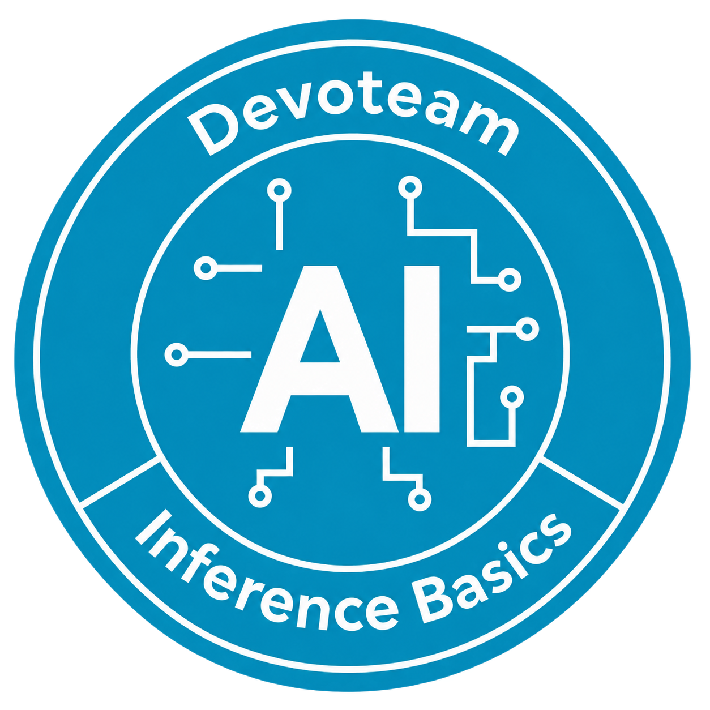

# AI Inference Basics



A disposable QEMU CPU lab with native single-node k0s and environment-selected Helmfile releases:
storage, TLS and gateway foundations, KServe inference services, Dex browser
authentication and one shared cluster-admin ttyd/Zellij and code-server workspace.
Each model has its own chart and namespace. The environment JSON selects installed
models, imports and zero or one inference replica. The CPU sample enables the three Qwen models.

```sh
task devenv:up     # create/provision the VM
task devenv:ssh    # connect to the VM
task devenv:down   # destroy the VM
```

See [local setup](docs/devenv.md) before the first run. The root Taskfile exposes
the upstream devenv tasks directly. The lab pulls its images from public GHCR packages;
see [lab access and qualification](docs/lab.md).

## Structure

- `.devenv/config.k`: local VM provisioning, based on `exemple.config.k`.
- `platform/k0s/k0s.yaml`: minimal native k0s configuration, copied directly by Ignition.
- `platform/helmfile/`: ordered Helmfile releases, upstream chart values and checks.
- `infra/`: environment JSON schema/sample and the shared Helmfile values adapter.
- `platform/units/`: inline tool installers, per-user kubeconfig generation and platform bootstrap.
- `platform/cloud-init/`, `platform/terraform/`: empty local placeholders, no cloud code.
- `oci/bastion/`: Fedora Minimal administration image with Zellij and CLI tools.
- `charts/`: six model charts, shared bastion, gateway/TLS and Dex configuration.
- `tests/`: render checks and opt-in runtime qualification; `reports/` stays local and ignored.

See [the platform](docs/platform.md) for upstream chart references, namespace
boundaries, deployment and test commands.
See [the lab](docs/lab.md) for browser paths, model APIs, credentials and image import.

**Current layout:** one Dex account named `cluster-admin` for pair training, full Kubernetes
administration from the bastion and Headlamp, separate Bearer model APIs and
one shared RustFS account restricted to the models bucket. The CPU environment
sample specifies 12 vCPU, 48 GiB RAM and 64 GiB disk; the private environment JSON
is the sizing source for `.devenv/config.k`. The bootstrap fetches the pinned
bastion and provision manifests before Helmfile runs. See [qualification](docs/lab.md#validation).

**Foundation history:** a temporary
Gateway/Agent Router route returned a mock OpenAI response; signed S3 operations
and anonymous rejection passed, and test resources were removed. Reexecuting the
bootstrap preserved the PVC and credential Secrets. A subsequent user-initiated
down/up qualified the full foundation bootstrap from a clean VM without intervention.
All six releases reached revision 1 and both RustFS hooks completed. The former storage-bootstrap chart is removed;
no existing buckets were deleted.
RustFS credential generation and bucket initialization now run as pre/post Helm
hooks in extraManifests. Fresh-namespace creation, upgrade preservation and scoped
RBAC were qualified; the host credential service has been removed.

[Documentation](docs/README.md) · [Implementation status](docs/implementation-tracker.md)
