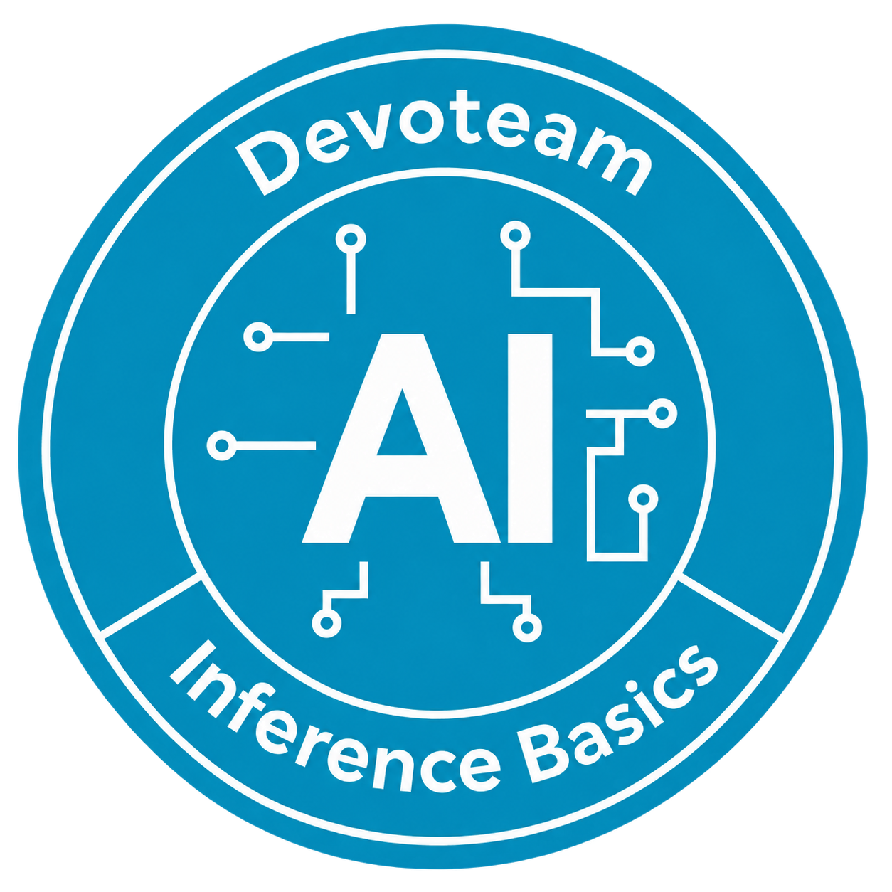

# Documentation

- [Local setup](devenv.md)
- [Current CPU lab: access, image import and qualification](lab.md)
- [Environment definition and model selection](infrastructure-definition.md)
- [Native model context windows](token-budgets.md)
- [GPU configuration and qualification limits](gpu.md)
- [CI, render and runtime test inventory](../tests/README.md)
- [Architecture](architecture.md)
- [Operations](operations-runbook.md)
- [Bastions and browser access](workspaces.md)
- [Security](security-and-access.md)
- [Browser HTTP requester](requester.md)
- [Model API](api.md)
- [Observability](observability.md)
- [Acceptance](acceptance.md)
- [Versions](versions-and-compatibility.md)
- [CI and distribution](ci-and-distribution.md)
- [Implementation status](implementation-tracker.md)
- [Troubleshooting](troubleshooting.md)
- [Release notes](release-notes.md)
