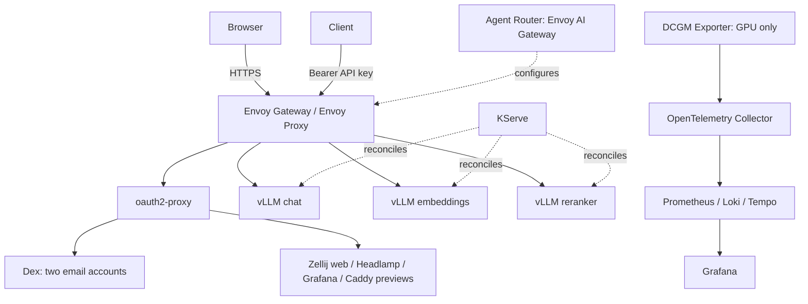

# Architecture and scope

## Platform

One Linux host runs native k0s as a single controller+worker. All application and
administration services run in Kubernetes. Task orchestrates infrastructure and
staged Helm deployment: foundation CRDs/controllers, browser access, AI controllers,
GPU prerequisites where applicable, models, observability and verification.

The project-owned umbrella chart is the configuration authority. Upstream charts
are used where supported. Namespace or CRD ownership constraints may require a
small set of staged releases under the same dependency lock; document exceptions.
Helm CRDs require explicit upgrade/deletion handling outside ordinary rollback.

KServe and Agent Router are controllers, not mandatory token-stream proxy hops.
Chat must use `LLMInferenceService` without llm-d/EPP. Embedding and reranking use
`InferenceService` with compatible vLLM pooling/classification runners. Compatibility
is an implementation gate, not assumed from CRD availability.

## Profiles

| Setting | local-cpu | scaleway-cpu-pilot | scaleway-h100 |
| --- | --- | --- | --- |
| OS | Fedora CoreOS via devenv | Ubuntu 24.04 | Noble GPU OS 13 |
| Compute | 12 vCPU / 32 GiB | >=8 vCPU / 32 GiB | H100-1-80G, fr-par-2 candidate |
| Disk | 64 GiB | 80–128 GB | 128 GB Block Storage 5K |
| Chat | Qwen/Qwen3-0.6B x1 | Same | Qwen/Qwen3-8B-FP8 x2 |
| Embedding | Qwen/Qwen3-Embedding-0.6B | Same | Qwen/Qwen3-Embedding-4B BF16 |
| Reranker | Qwen/Qwen3-Reranker-0.6B | Same | Qwen/Qwen3-Reranker-4B BF16 |
| Browser identity | Dex + oauth2-proxy | Same | Same, two accounts per lab |
| HAMi/DCGM | Disabled | Disabled | Enabled |

Aliases remain `ai-inference-basics-chat`, `ai-inference-basics-embeddings`, `ai-inference-basics-rerank`. Pin HF commit revisions.
CPU starts at context 2048, output 128 tokens, one active pipeline, bounded threads
and KV memory; BF16 requires verified guest CPU support, otherwise test FP32.
H100 starts at context 4096 with bounded concurrency; provisional HAMi allocations
20+20+13+13 GiB need measurement and leave driver headroom. No extra quantization.

## Explicit exclusions

No Google, Keycloak, llm-d/EPP, disaggregated serving, GPU Operator, competing NVIDIA
device plugin, KAI, Volcano, KEDA, Knative, Istio, Dynamo or multicluster. No
code-server, Warpgate, Timoni or nested k0s. Game UI, incident content, vector DB and
RAG orchestration belong to a later project. A tiny demo suffices for previews.
